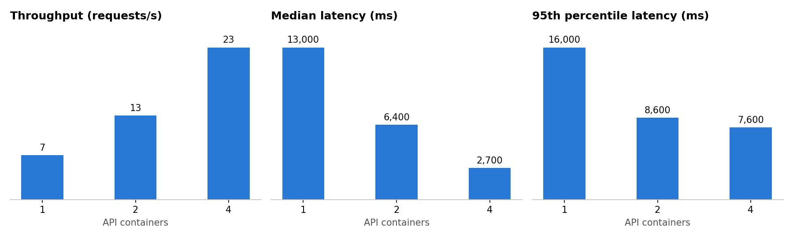

# Mosquito Species from Wingbeat Sound: an End-to-End ML Pipeline

**Video demo:** [YouTube link](https://youtu.be/IK1q60HMkD0)
**App URL:** http://localhost:8080 (runs in Docker, see [Setup](#setup))
**API docs:** http://localhost:8080/docs

## Project description

Malaria is spread only by *Anopheles* mosquitoes, and knowing which species are present in an area tells health workers where bed nets and spraying will help most. Today this means catching mosquitoes and identifying them under a microscope, which needs a trained entomologist. A flying mosquito makes a buzz whose pitch and overtones depend on its species, so a recording can do part of that job.

This project takes a short audio recording and classifies it as one of four classes:

| Class | Malaria vector? |
|---|---|
| *Anopheles arabiensis* | yes |
| *Anopheles funestus* | yes |
| *Culex pipiens* complex | no |
| Background (no mosquito) | no |

It covers the full ML cycle:

- **Data acquisition:** [HumBugDB](https://zenodo.org/records/4904800) (Kiskin et al., NeurIPS 2021, CC BY 4.0). To stop the model from learning the recording setup instead of the insect, I only use recordings made in Tanzania with the same method (mosquito in a cup, Tascam recorder, 44.1 kHz, females only). Each class is split **by recording night**, so no night appears in more than one of train, validation and test. Every class has 900 train, 200 validation and 200 test clips of 2 seconds.
- **Preprocessing:** audio is decoded, mixed to mono, resampled to 8 kHz and cut into 2 second windows. Each window becomes a fine log spectrogram (1024 point FFT, 150 to 2000 Hz, 7.8 Hz per row). Each frequency's median over the window is subtracted to remove steady recorder and room noise, then the spectrogram is standardised.
- **Model:** a small CNN (three convolution blocks, about 288k parameters) trained from scratch, with SpecAugment style augmentation, dropout, L2, early stopping and learning-rate reduction.
- **API:** FastAPI service for prediction, bulk upload, retraining and monitoring.
- **UI:** a web dashboard with model uptime, evaluation results, three data insight charts, single recording prediction with its spectrogram, bulk upload and a retrain button.
- **Retraining:** uploaded recordings are stored in a SQLite database, cut into clips with the same preprocessing, and used to continue training the model in service. The new version only replaces the old one if it does better on validation.
- **Deployment:** Docker containers behind an nginx load balancer. Locust floods the API with requests across 1, 2 and 4 containers.

## Model evaluation

Results on the held-out **test set of 800 clips** from recording nights that were never used for training or for choosing the model:

| Metric | Optimized model | Baseline |
|---|---|---|
| Accuracy | **0.671** | 0.600 |
| Precision (macro) | **0.675** | 0.670 |
| Recall (macro) | **0.671** | 0.600 |
| F1 score (macro) | **0.667** | 0.561 |
| ROC-AUC (one vs rest) | **0.884** | 0.873 |
| Cohen's kappa | **0.562** | 0.467 |
| Loss | **0.760** | 0.921 |

The baseline is the same network trained without augmentation, dropout or L2. Its training accuracy went past 0.9 while validation stayed around 0.5, so it was memorising the training nights. The optimized model is better on every metric, and the biggest gain is on *An. funestus* (117 of 200 test clips right, against 43 for the baseline).

Confusion matrix of the optimized model (rows are the true class, columns are the predicted class):

| | An. arabiensis | An. funestus | Culex | Background |
|---|---|---|---|---|
| **An. arabiensis** | 129 | 31 | 30 | 10 |
| **An. funestus** | 49 | 117 | 13 | 21 |
| **Culex** | 66 | 21 | 103 | 10 |
| **Background** | 2 | 7 | 3 | 188 |

- Background is the easiest class (recall 0.94). Most mistakes are between species, especially *Culex* predicted as *An. arabiensis*.
- **Malaria vector or not:** 326 of 400 *Anopheles* clips (81.5%) were flagged as a malaria vector, and the vector / non-vector answer is right on 78.8% of clips.
- **Whole recordings:** the API averages all 2 s windows in a recording. Grouping the test clips this way gives **0.741 accuracy and 0.757 macro F1 on 205 test recordings**.

I first used a 64 band mel spectrogram, the usual choice for audio. Each mel band was about 30 Hz wide here, while the species differ by 30 to 60 Hz in wingbeat. Switching to the finer spectrogram with steady noise removed raised validation accuracy from 0.515 to 0.615. I chose the input by validation score only, so the test set played no part in that decision.

The full preprocessing, training, evaluation and prediction steps are in [notebook/mosquito_wingbeat.ipynb](notebook/mosquito_wingbeat.ipynb).

## Data insights

These three features were measured directly from the sound of all 3,600 training clips, ignoring energy below 150 Hz (mains and room hum). All three are charted in the dashboard.

1. **Wingbeat frequency:** the typical wingbeat tone is 480 Hz for *An. funestus*, 450 Hz for *Culex* and 416 Hz for *An. arabiensis*. The ranges overlap a lot, so pitch alone cannot name the species, and this is why the model needs fine frequency detail and the way the sound changes over time.
2. **Brightness (spectral centroid):** mosquito clips have a typical centre of 792 to 830 Hz, against 572 Hz for background. The three species are almost identical here, so brightness tells you whether a mosquito is present, not which one.
3. **Tonal strength:** in a typical mosquito clip 19 to 21% of the energy sits on the wingbeat and its harmonics, about twice the 10% of background. A buzz is a clean tone with overtones, while room noise is spread out.

Together these explain the results: separating mosquito from background is easy, and the real difficulty is between species.

## Setup

### Option 1: Docker (recommended)

Requirements: [Docker Desktop](https://www.docker.com/products/docker-desktop/) with at least 4 GB of memory available.

```bash
git clone https://github.com/Aderline490/mosquito-wingbeat-mlops.git
cd mosquito-wingbeat-mlops
docker compose up -d --build --wait --scale api=4
```

Open http://localhost:8080 for the dashboard. The first build downloads TensorFlow and takes several minutes.

- Change the number of API containers: `docker compose up -d --wait --scale api=2`
- Stop everything: `docker compose down`. Add `-v` to also delete uploads and retrained versions.
- To protect uploads and retraining on a shared machine, set `ADMIN_TOKEN=your-secret` before `docker compose up`. Then enter it in the API key box that appears in the dashboard.

### Option 2: Run locally with Python

Requirements: Python 3.9 and libsndfile (included with the `soundfile` wheels on Windows and macOS; on Linux, `apt install libsndfile1`).

```bash
python3.9 -m venv .venv
source .venv/bin/activate        # Windows: .venv\Scripts\activate
pip install -r requirements.txt
uvicorn src.api:app --port 8000
```

Open http://localhost:8000.

Other commands, run from the project root:

| Task | Command |
|---|---|
| Predict one recording from the terminal | `python -m src.prediction demo/predict/demo_an_funestus.wav` |
| Download HumBugDB and rebuild `data/` | `python scripts/prepare_data.py` |
| Train the baseline and the first model version | `python -m src.train` |
| Recompute the data insights | `python -m src.insights` |
| Run the notebook | `pip install -r requirements-dev.txt`, then `jupyter notebook notebook/mosquito_wingbeat.ipynb` |

## Using the app

**Predict one recording:** in the dashboard, choose a WAV, FLAC or OGG file (1 to 120 seconds) and press Predict. The app shows the predicted class, whether it is a malaria vector, the confidence, the probability of each class, how many 2 s windows agreed, the estimated wingbeat frequency and the spectrogram. [demo/predict/](demo/predict/) has one 10 second test recording per class. The model in service predicts all four correctly.

**Retrain:**

1. Under **Upload data and retrain**, pick the true class, select several recordings and press **Upload recordings**. Each file is checked (format, length, not silent) and saved to the database. Duplicates and any file that matches a validation or test clip are rejected, so they can't leak into evaluation. [demo/retrain/](demo/retrain/) has four labelled recordings per class to try this with.
2. Press **Retrain model**. You need at least 6 uploaded recordings. The job runs in the background, and the dashboard shows its progress epoch by epoch.
3. Each upload is cut into 2 s clips. Retraining starts from the model in service and continues training on the original training clips plus the new ones, at a lower learning rate and with class weights.
4. The new version is compared with the current one on the validation set. It only goes into service if its macro F1 is higher (lower loss breaks ties). The switch happens without restarting the API.

In my test, 16 uploaded recordings became 65 new clips. After 5 epochs the new version scored 0.580 validation F1 against 0.595 for the model in service, so it was correctly kept out of service. On one container CPU, a retraining job takes about 35 to 40 minutes. Set `RETRAIN_EPOCHS` to change the number of epochs.

Retraining can also start automatically: set `AUTO_RETRAIN=true` to start it after 20 new uploads. Change `RETRAIN_AUTO_THRESHOLD` to use a different number.

### API endpoints

| Method | Path | Purpose |
|---|---|---|
| GET | `/health` | Uptime, model version, request and error counts |
| POST | `/predict` | Classify one uploaded recording |
| POST | `/upload` | Bulk upload labelled recordings for retraining |
| GET | `/uploads/summary` | Uploaded recordings waiting for retraining |
| POST | `/retrain` | Start a retraining job |
| GET | `/retrain/{job_id}` | Status of a retraining job |
| GET | `/retrain/jobs` | Recent retraining jobs |
| GET | `/model/metrics` | Evaluation results of the model in service |
| GET | `/insights` | Feature data behind the dashboard charts |
| GET | `/classes` | List of classes |

Interactive documentation is at `/docs`.

## Flood request simulation (Locust)

Locust sent the four 10 second demo recordings to `POST /predict` through the nginx gateway while the number of API containers changed. Each container was limited to 1 CPU and 2 GB of memory. Each simulated user waited 0.5 to 1.5 seconds between requests, and every response was checked for the correct label, not just a 200 status. The ramp-up period is excluded from the numbers.

**100 users for 75 seconds (overloaded):**

| API containers | Requests | Failures | Requests/s | Median (ms) | 95th percentile (ms) | 99th percentile (ms) |
|---|---|---|---|---|---|---|
| 1 | 512 | 0 | 6.8 | 13,000 | 16,000 | 17,000 |
| 2 | 918 | 0 | 12.9 | 6,400 | 8,600 | 9,100 |
| 4 | 1,689 | 0 | 23.4 | 2,700 | 7,600 | 9,000 |



Each prediction scores five 2 s windows, which keeps one CPU busy for roughly 150 ms. With 100 users every container sat at 100% CPU and requests queued. Throughput grew almost in step with the number of containers (3.4 times more requests per second with 4 than with 1), and the median response time fell from 13 seconds to 2.7 seconds. No request failed in any run.

**10 users for 60 seconds (normal load):**

| API containers | Requests | Failures | Requests/s | Median (ms) | 95th percentile (ms) |
|---|---|---|---|---|---|
| 1 | 372 | 0 | 6.3 | 430 | 750 |
| 2 | 438 | 0 | 7.4 | 190 | 470 |
| 4 | 450 | 0 | 7.6 | 170 | 350 |

At this load one container was close to its limit, and a second one brought the median down from 430 ms to 190 ms. Going to four helped less, because there was little queueing left to remove.

These tests ran on one laptop, with Locust on the same machine as the containers, and each setup was run once. Full HTML reports are in [results/locust/](results/locust/).

To repeat the test, install the dev requirements and pass the number of users and the duration:

```bash
pip install -r requirements-dev.txt
scripts/run_load_tests.sh 100 75s
```

## Project structure

```
mosquito-wingbeat-mlops/
├── README.md
├── notebook/
│   └── mosquito_wingbeat.ipynb   # preprocessing, training, evaluation, prediction
├── src/
│   ├── preprocessing.py          # audio loading, windows and spectrograms
│   ├── model.py                  # model building, training and evaluation
│   ├── prediction.py             # loads the model in service and predicts
│   ├── train.py                  # trains the baseline and the first model version
│   ├── retrain.py                # retraining with validation-based promotion
│   ├── insights.py               # acoustic features for the data insights
│   ├── database.py               # SQLite storage for uploads and jobs
│   ├── config.py                 # settings
│   └── api.py                    # FastAPI application
├── ui/                           # web dashboard (HTML, CSS, JavaScript)
├── data/
│   ├── train/                    # 2 s clips, one folder per class
│   ├── validation/
│   ├── test/
│   └── manifest.csv              # recording id and night of every clip
├── models/
│   ├── wingbeat_model.keras      # model in service (Keras format)
│   ├── wingbeat_model.h5         # same model saved as .h5 (TensorFlow/Keras HDF5)
│   ├── baseline_model.keras      # unoptimized baseline for comparison
│   ├── metrics.json
│   ├── baseline_metrics.json
│   ├── history.json
│   └── insights.json
├── demo/
│   ├── predict/                  # one held-out test recording per class
│   └── retrain/                  # labelled recordings for trying retraining
├── load_tests/locustfile.py
├── results/locust/               # load test results
├── scripts/                      # data preparation, demo selection, load tests
├── deploy/nginx.conf             # load balancer configuration
├── Dockerfile
└── docker-compose.yml
```

## Limitations

- All recordings come from one study in Tanzania, made in cups with one recorder model. Phone recordings in a house would sound different and would need retraining.
- The *An. arabiensis* test set comes from only 2 recording nights, so its scores could change with other nights.
- Only female mosquitoes are included.

## Dataset credit

HumBugDB: Kiskin, I., Sinka, M., Cobb, A. D., et al. "HumBugDB: A Large-scale Acoustic Mosquito Dataset." NeurIPS 2021 Datasets and Benchmarks Track. Zenodo record 4904800, released under CC BY 4.0. The clips in `data/` and `demo/` are cut from these recordings.
